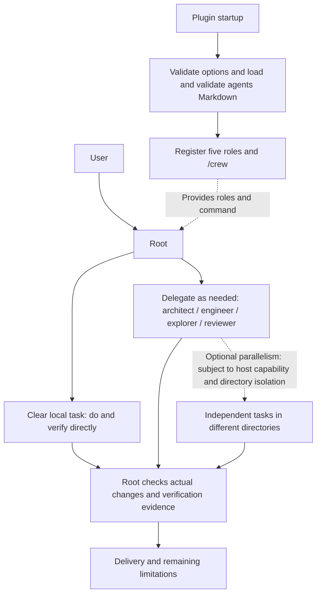

# OpenCode Crew

English | [简体中文](README.zh-CN.md)

An OpenCode V2 plugin with file-based roles and delegation on demand. Root retains normal execution capabilities: do simple work directly, divide complex work as needed, and check results according to risk.

## How it works and parallel execution



Specialists are selected as needed, not a fixed sequence or mandatory stages. Root's policy allows only one writer in the same cwd at a time; Root and engineer must not modify it simultaneously, and independent review follows completion of writes. Parallelism is considered only for independent tasks in different directories.

The plugin only registers roles and a command. It has no scheduler, queue, concurrency limit, lock, automatic worktree, dependency DAG, or conflict detection of its own. Actual subagent calls and concurrent execution depend on OpenCode host capabilities and Root's tool usage; parallel execution is not claimed to have been tested here.

## Installation and configuration

Requires OpenCode **2.2.3** (the verified version). No manual role copying or installation script is required.

### Install from GitHub (recommended)

```sh
opencode plugin add github:bioShaun/opencode-crew
```

A full Git URL also works:

```sh
opencode plugin add git+https://github.com/bioShaun/opencode-crew.git
```

After installation, find the Crew plugin entry added by the command in your existing `opencode.json(c)` and change it to the object form below to configure models. **Replace that entry; do not append a second copy.** The repository includes a prebuilt entry point; users do not need to create roles or run a build manually.

```jsonc
{
  "$schema": "https://opencode.ai/config.json",
  "plugins": [
    {
      "package": "github:bioShaun/opencode-crew",
      "options": {
        "models": {
          "root": "provider/root-model#high",
          "architect": "provider/architect-model#high",
          "engineer": "provider/implementation-model#medium",
          "explorer": "provider/fast-model",
          "reviewer": "provider/review-model#high"
        },
        "steps": { "engineer": 80, "reviewer": 30 }
      }
    }
  ],
  "default_agent": "root"
}
```

These models are placeholders to replace. Providers, credentials and model availability come from the target machine's configuration; the package contains no keys or concrete model defaults. Roles may be omitted from `models`: omission follows native OpenCode model inheritance, not the string `inherit`. Subagents inherit the parent session model; the primary session keeps its selected model. `/crew` explicitly selects the configured Root model, or retains the current session model if none is configured.

Do not overwrite your complete existing configuration; retain providers and other plugins. Do not also define Crew's five identically named roles in `agents` configuration or auto-discovered `agents/*.md`: host merge rules may override models or prompts or append permissions. Users migrating from the old planner-only setup should back up and move out the old role files, then remove their configuration blocks; do not enable both orchestration packages together.

You can pin a branch, tag or full commit, for example `github:bioShaun/opencode-crew#main`. For production, consider pinning a verified full commit. Use `opencode plugin check` / `opencode plugin update` to inspect or update; a plugin pinned to a full commit does not follow branch updates.

### Local directory / offline distribution

You can place the complete repository at any fixed location and set `package` to its absolute path (for example `/home/you/opencode/opencode-crew`). The plugin does not depend on a particular installation path.

A tgz generated by `npm pack` can be distributed and extracted to a fixed directory on the target machine, then loaded by local path. `plugin add` does not accept a tgz target. Both the archive and Git repository include `dist/index.js` with the YAML parser bundled; no separate parser installation is required. After modifying source, run `bun install && bun run build` before distributing. Runtime still depends on the host OpenCode V2 plugin SDK. The package is not currently published to npm; do not install it from npm by bare package name.

## Usage

- `/crew`: switch to Root and the configured Root model, without sending an empty model request.
- `/crew <task>`: switch and submit a task, preserving attachments, skills and delivery mode.
- `default_agent: root` applies to new sessions without a selected agent; it does not forcibly change existing sessions. Use `/crew` in an existing session.
- Change models/steps in plugin options; OpenCode's configuration hot reload mechanism applies them without restarting the service.

## Roles

| Role | Purpose | Permission boundary |
|---|---|---|
| root | Goals, decisions, coordination and acceptance; may directly perform and verify clear local tasks | No planner-only tool prohibition; still subject to host and session policies |
| architect | Design complex plans, interfaces and verification contracts as needed | Can write only cwd `plans/`; no shell or Code Mode |
| engineer | Implement within scope and self-verify | No recursive delegation; default 80 steps |
| explorer | Read-only searches, logs and call-chain summaries | No writes or command execution |
| reviewer | Independent risk-based review | No writes; shell limited to five fixed read-only Git commands |

When Root's Markdown permission list is empty, Crew leaves the host-provided Root permissions unchanged; it does not add a wildcard allow or bypass existing ask/deny rules. Nonempty Root rules replace that list. Session and other host policies still apply.

This is not a fixed pipeline. Root may work directly when it already has context, the remaining changes and necessary verification are clear and local, and no further investigation, test design or independent review is needed; otherwise it prefers delegation. Use `plans/` as needed for long tasks. Only one writer may modify a cwd at a time; direct work still requires acceptance checks.

## Roles as files

```text
opencode-crew/
├── package.json
├── src/index.ts           # parse configuration, load roles, register /crew
├── dist/index.js          # distribution entry, includes YAML parser
└── agents/
    ├── root.md
    ├── architect.md
    ├── engineer.md
    ├── explorer.md
    └── reviewer.md
```

Role prompts, permissions and default steps live only in Markdown; plugin source does not maintain a second copy. Frontmatter supports `description`, `mode`, `steps` and `permissions`; the body is the system prompt. Models are set only through plugin options. Invalid fields, roles or model formats fail immediately; all input is validated before registration.

After changing packaged Markdown, use OpenCode `/reload` to force a full reload and reread roles; automatic host watching of all nested package files is not guaranteed. Package upgrades may overwrite customized Markdown, so preserve custom files before upgrading. There is currently no separate custom directory/alias mechanism, to avoid duplicate definitions.

## Verification and limitations

Run `bun test` after `bun install`. Acceptance tests cover model parsing, native Root, read-only roles, plans write scope, command switching and attachment preservation, invalid configuration and empty commands.

Configuration/registration and permission readback do not prove a real model execution path. Paid multi-turn Root→subagent tasks have not been run; results also depend on the target machine's provider, global/session permissions and project instructions. Path permissions are not an operating-system sandbox; untrusted projects require additional isolation.

To uninstall, remove the Crew plugin entry and `default_agent: root` from configuration (or restore the previous default); remove the local package yourself when no longer used. After removal, do not continue using root in existing sessions; select build or the restored planner instead. Roll back only configuration items involved in the migration to avoid overwriting unrelated later changes.
