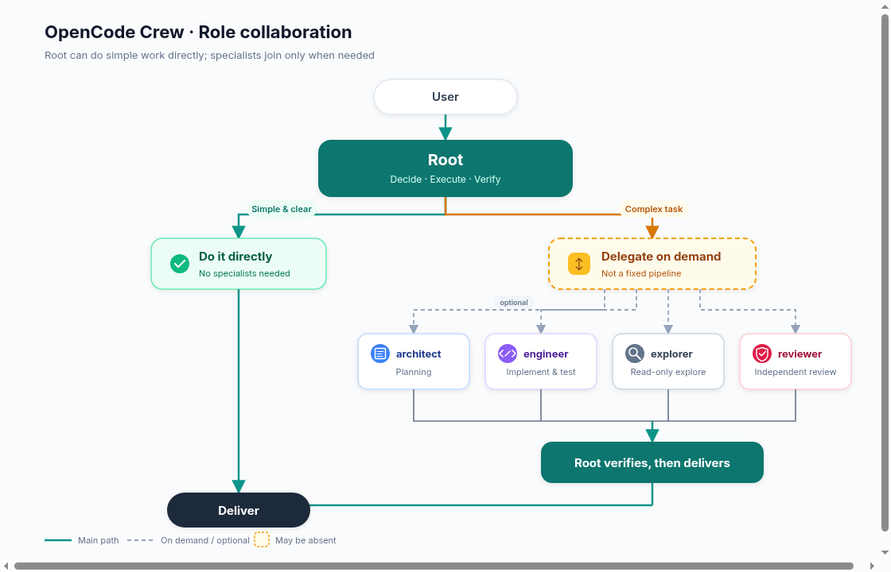

# OpenCode Crew

English | [简体中文](README.zh-CN.md)

An OpenCode V2 plugin with file-based roles and delegation on demand. Root retains normal execution capabilities: do simple work directly, divide complex work as needed, and check results according to risk.

## Role design and workflow



Editable source: [`docs/role-collaboration.en.svg`](docs/role-collaboration.en.svg).

Root completes and verifies simple, clear tasks directly. For complex tasks, it delegates to specialists as needed, checks the results and delivers the outcome. The four specialists are not a fixed pipeline and do not all need to participate in every task.

### Parallel execution

Root's policy allows only one writer in the same cwd at a time; Root and engineer must not modify it simultaneously, and independent review follows completion of writes. Parallelism is considered only for independent tasks in different directories.

Native delegation remains host-controlled and is not automatically isolated. Separately, the explicit `crew_task_*` tools bind a manually prepared worktree to an independent engineer session with a limited local ledger and lock; they are not a scheduler, DAG, or automatic worktree manager. Two real engineer tasks have run in a private host, but their execution overlap was not verified.

## Installation and configuration

The role/plugin dependency baseline is OpenCode **2.2.3**. Stage 1 private-host validation used **2.2.5**; stage 2 S1–S3 have local tests, S4 ran a private 2.2.5 fixture turnover with CLI evidence, and S5 ran a private two-task serial-integration fixture trial; none touched the real ledger. No manual role copying or installation script is required.

### Install from GitHub (recommended)

```sh
opencode plugin add github:bioShaun/opencode-crew
```

A full Git URL also works:

```sh
opencode plugin add git+https://github.com/bioShaun/opencode-crew.git
```

After installation, find the Crew plugin entry added by the command in your existing `opencode.json(c)` and change it to the object form below to configure models. **Replace that entry; do not append a second copy.** The repository includes a prebuilt entry point; users do not need to create roles or run a build manually.

```jsonc
{
  "$schema": "https://opencode.ai/config.json",
  "plugins": [
    {
      "package": "github:bioShaun/opencode-crew",
      "options": {
        "models": {
          "root": "provider/root-model#high",
          "architect": "provider/architect-model#high",
          "engineer": "provider/implementation-model#medium",
          "explorer": "provider/fast-model",
          "reviewer": "provider/review-model#high"
        },
        "steps": { "engineer": 80, "reviewer": 30 }
      }
    }
  ],
  "default_agent": "root"
}
```

These models are placeholders to replace. Providers, credentials and model availability come from the target machine's configuration; the package contains no keys or concrete model defaults. Roles may be omitted from `models`: omission follows native OpenCode model inheritance, not the string `inherit`. Subagents inherit the parent session model; the primary session keeps its selected model. `/crew` explicitly selects the configured Root model, or retains the current session model if none is configured.

Do not overwrite your complete existing configuration; retain providers and other plugins. Do not also define Crew's five identically named roles in `agents` configuration or auto-discovered `agents/*.md`: host merge rules may override models or prompts or append permissions. Users migrating from the old planner-only setup should back up and move out the old role files, then remove their configuration blocks; do not enable both orchestration packages together.

You can pin a branch, tag or full commit, for example `github:bioShaun/opencode-crew#main`. For production, consider pinning a verified full commit. Use `opencode plugin check` / `opencode plugin update` to inspect or update; a plugin pinned to a full commit does not follow branch updates.

### Local directory / offline distribution

You can place the complete repository at any fixed location and set `package` to its absolute path (for example `/home/you/opencode/opencode-crew`). The plugin does not depend on a particular installation path.

A tgz generated by `npm pack` can be distributed and extracted to a fixed directory on the target machine, then loaded by local path. `plugin add` does not accept a tgz target. Both the archive and Git repository include `dist/index.js` with the YAML parser bundled; no separate parser installation is required. After modifying source, run `bun install && bun run build` before distributing. Runtime still depends on the host OpenCode V2 plugin SDK. The package is not currently published to npm; do not install it from npm by bare package name.

## Usage

- `/crew`: switch to Root and the configured Root model, without sending an empty model request.
- `/crew <task>`: switch and submit a task, preserving attachments, skills and delivery mode.
- `default_agent: root` applies to new sessions without a selected agent; it does not forcibly change existing sessions. Use `/crew` in an existing session.
- Change models/steps in plugin options; OpenCode's configuration hot reload mechanism applies them without restarting the service.

### Explicit worktree tasks

From the Root session in the **primary worktree root**, call `crew_task_start` with `{key, directory, baseline, scope, goal, acceptance, check}`; `scope` is an array of exact relative paths or directory prefixes ending in `/`, not globs. `crew_task_status` takes `{taskID?}` and `crew_task_stop` takes `{taskID}`. These are plugin-managed independent sessions, not native subagent isolation or automatic isolation of every delegation.

Prepare a sibling detached worktree manually, with both worktrees clean and at the same full commit OID (do not run this example in a dirty primary):

```sh
git status --porcelain
baseline=$(git rev-parse HEAD)
git worktree add --detach ../crew-task "$baseline"
git -C ../crew-task status --porcelain
git -C ../crew-task rev-parse HEAD
# Use the absolute path of ../crew-task as directory and $baseline as baseline.
```

At most two unresolved write reservations are held; there is no release or cleanup interface. Idle, error and stop do not release them. The ledger is under `<git-common-dir>/opencode-crew-stage1`; a crash lock is never automatically stolen. Do not treat manual ledger deletion as normal operation. Same key, owner and input replay returns the record without redelivery or resumption. Managed retry is disabled, not an automatic resume mechanism. Stop sends at most one interrupt request and cannot prove the process tree stopped; process safety remains `unconfirmed`. Worktrees and scope are not OS sandboxes. Review actual changes and independently establish safety before any manual integration; preserve uncertain workspaces and reservations.

### Registry v2 and offline maintenance (stage 2 S1–S3)

The v2 registry keeps closed tasks as permanent idempotency tombstones, so capacity can be released without deleting key, owner, baseline or cwd history. The three online tools keep their inputs: a closed key replay returns the original closed record with zero create/prompt/interrupt; `crew_task_status` without `taskID` still lists only active tasks, while an explicit `taskID` may return that owner's closed record; `crew_task_stop` on a closed record does not interrupt; the retry hook still disables retry for historical bindings. Closed records cannot re-enter transitions. v1 is never migrated implicitly: v1 keeps its original behavior, and older readers reject v2 rather than treating it as an empty ledger.

Offline maintenance is a local operator entry, not an online tool. There are no new model-facing release or cleanup tools:

```sh
bun src/maintenance-cli.ts plan  operation.json
bun src/maintenance-cli.ts apply plan.json
```

The operations are `migrate`, `close` and `open-period`. `plan` is read-only and binds the request to the current generation, registry digest, expected changes and evidence closure. `apply` requires the frozen authorization and evidence bundle, re-checks the plan and evidence, writes a backup and immutable archive, and then changes the registry in one atomic commit; a lost response is replayed from the stored operation ID without a second write. `close` only moves a reservation into history: it does not prove the process stopped, does not clean up or merge, and leaves the worktree bytes untouched. `open-period` requires zero active tasks and a valid, clean new baseline. Missing evidence, authorization or drain proof stays blocked and keeps the reservation.

The CLI writes exactly one machine JSON object to stdout and a short Chinese summary to stderr. Exit codes are `0` success, `1` refusal/blocked and `2` usage or malformed input. The bounded read-only review listing (`src/tasks-review.ts`) is consumed as close evidence; no online review tool is registered. Only one registry write is the commit point. Backups and archives are audit data, not alternate authorities; never delete the registry or its lock to regain capacity.

## Roles

| Role | Purpose | Permission boundary |
|---|---|---|
| root | Goals, decisions, coordination and acceptance; may directly perform and verify clear local tasks | No planner-only tool prohibition; still subject to host and session policies |
| architect | Design complex plans, interfaces and verification contracts as needed | Can write only cwd `plans/`; no shell or Code Mode |
| engineer | Implement within scope and self-verify | No recursive delegation; default 80 steps |
| explorer | Read-only searches, logs and call-chain summaries | No writes or command execution |
| reviewer | Independent risk-based review | No writes; shell limited to five fixed read-only Git commands |

When Root's Markdown permission list is empty, Crew leaves the host-provided Root permissions unchanged; it does not add a wildcard allow or bypass existing ask/deny rules. Nonempty Root rules replace that list. Session and other host policies still apply.

Engineer instead retains the host-provided permission rules in order and appends its Markdown rules: denials for `subagent`, `question`, and `execute`. Existing host allow/ask/deny rules otherwise remain effective; Crew does not add a wildcard allow. Architect, explorer, and reviewer continue to use their strict replacement policies.

The three strict roles allow skills and external-directory checks for routine reference reading, while their read rules still ask for `.env` and `.env.*` and allow `.env.example`. This does not grant external edits or shell access. Their other actions remain denied except the explicit role rules above. OpenCode path permissions are not a symlink-safe sandbox: a symlink inside `plans/` can undermine architect's intended write boundary, and an alias can obscure a sensitive filename. Do not use these role rules as isolation against untrusted filesystem layouts.

This is not a fixed pipeline. Root may work directly when it already has context, the remaining changes and necessary verification are clear and local, and no further investigation, test design or independent review is needed; otherwise it prefers delegation. Use `plans/` as needed for long tasks. Only one writer may modify a cwd at a time; direct work still requires acceptance checks.

## Roles as files

```text
opencode-crew/
├── package.json
├── src/index.ts             # parse configuration, load roles, register /crew
├── src/tasks-review.ts      # bounded read-only review listing
├── src/tasks-maintenance.ts # offline plan/apply for the registry
├── src/maintenance-cli.ts   # local maintenance entry
├── dist/index.js            # distribution entry, includes YAML parser
├── docs/                    # role-collaboration diagram (png + svg)
└── agents/
    ├── root.md
    ├── architect.md
    ├── engineer.md
    ├── explorer.md
    └── reviewer.md
```

Role prompts, permissions and default steps live only in Markdown; plugin source does not maintain a second copy. Frontmatter supports `description`, `mode`, `steps` and `permissions`; the body is the system prompt. Models are set only through plugin options. Invalid fields, roles or model formats fail immediately; all input is validated before registration.

After changing packaged Markdown, use OpenCode `/reload` to force a full reload and reread roles; automatic host watching of all nested package files is not guaranteed. Package upgrades may overwrite customized Markdown, so preserve custom files before upgrading. There is currently no separate custom directory/alias mechanism, to avoid duplicate definitions.

## Verification and limitations

Run `bun test` after `bun install`; default discovery is restricted to `test/`. Tests cover role configuration, the limited task tools, v1/v2 compatibility, closed-history behavior, the read-only listing, and offline maintenance plan/apply including replay, evidence limits and failure atomicity. Local tests do not prove the complete host acceptance matrix.

A private host exercised the stage 1 real Root tool calls and two independent engineer marker tasks, including replay, capacity and stop status. Stage 2 S1–S3 have local red/green and regression evidence; S4 completed a private 2.2.5 fixture turnover (v1→v2 migration, three evidence-backed closes, zero-write closed replay, different-owner conflict, a new period and a new task); S5 ran two real behavior tasks from one baseline through engineer sub-sessions, serially integrated them with per-step and full regression, and completed integrated closeouts, a new-period turnover, closed replay and a different-owner conflict in a private fixture; the fixture integration commits were not ported to the source workspace. None of these touched the real ledger. The stage 1 results do not prove overlapping execution, real permission-denial prompts or process-tree termination. Runner and verification limitations are recorded in `plans/worktree-stage1-results.md` in the source workspace. Results also depend on provider, global/session permissions and project instructions. Path permissions are not an operating-system sandbox; untrusted projects require additional isolation.

To uninstall, remove the Crew plugin entry and `default_agent: root` from configuration (or restore the previous default); remove the local package yourself when no longer used. After removal, do not continue using root in existing sessions; select build or the restored planner instead. Roll back only configuration items involved in the migration to avoid overwriting unrelated later changes.
