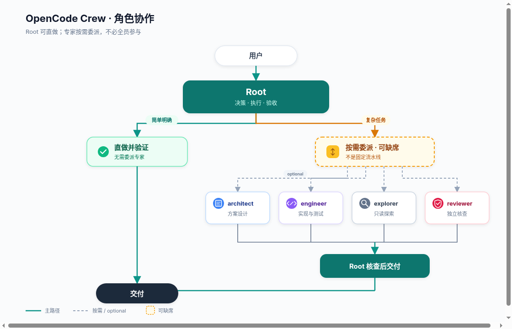

# OpenCode Crew

[English](README.md) | 简体中文

OpenCode V2 插件：文件化角色、按需委派，Root 保持正常执行能力。简单事情直接做，复杂事情分工做，结果按风险核查。

## 角色设计与工作方式



可编辑源文件：[`docs/role-collaboration.svg`](docs/role-collaboration.svg)。

简单明确的任务由 Root 直接完成并验证；复杂任务按需委派给专家，由 Root 核查结果后交付。四类专家不是固定流水线，也不要求每次全部参与。

### 并行现状

Root 策略规定同一 cwd 同时只有一个写入者，Root 与 engineer 不同时修改；写入结束后再独立审查。仅不同目录的独立任务才考虑并行。

GPT 与 Claude 提示风格的轻量差异（角色可选附录 + 运行时短 hint，非整段双轨 preset）见 [`docs/model-family-prompts.md`](docs/model-family-prompts.md)。

原生委派仍由宿主控制，不自动隔离。另有显式 `crew_task_*` 工具，将手工准备的 worktree 绑定到独立 engineer 会话，并使用受限本地 ledger 与锁；它不是调度器、DAG 或自动 worktree 管理器。私有宿主已运行两个真实 engineer 任务，但未验证执行时间重叠。

## 安装与配置

角色与插件依赖基线为 OpenCode **2.2.3**。阶段 1 私有宿主验收使用 **2.2.5**；阶段 2 的 S1–S3 目前只有本地测试，尚未在真实宿主验证。无需手工复制角色或运行安装脚本。

### 从 GitHub 安装（推荐）

```sh
opencode plugin add github:bioShaun/opencode-crew
```

也支持完整 Git 地址：

```sh
opencode plugin add git+https://github.com/bioShaun/opencode-crew.git
```

安装后，在已有 `opencode.json(c)` 中找到安装命令添加的 Crew 插件项，将它改成下方对象形式以配置模型。**替换该项，不要再追加第二份。** 仓库自带预构建入口，使用者无需手工创建角色或运行构建命令。

```jsonc
{
  "$schema": "https://opencode.ai/config.json",
  "plugins": [
    {
      "package": "github:bioShaun/opencode-crew",
      "options": {
        "models": {
          "root": "provider/root-model#high",
          "architect": "provider/architect-model#high",
          "engineer": "provider/implementation-model#medium",
          "explorer": "provider/fast-model",
          "reviewer": "provider/review-model#high"
        },
        "steps": { "engineer": 80, "reviewer": 30 }
      }
    }
  ],
  "default_agent": "root"
}
```

以上是待替换的占位模型，provider、凭证和模型可用性由目标机配置提供，包内不包含密钥或具体模型默认值。`models` 可省略部分角色；省略表示遵循 OpenCode 原生模型继承规则，不是字符串 `inherit`。子代理继承父会话模型；主会话保持其已选模型。`/crew` 会显式选择已配置的 Root 模型，未配置则保留当前会话模型。

不要覆盖现有完整配置，保留 provider 和其他插件。不要再在 `agents` 配置或自动发现的 `agents/*.md` 中定义 Crew 的五个同名角色，否则宿主的合并规则可能覆盖模型/提示词或追加权限。旧 planner-only 用户先备份并移出旧角色文件，再删除其配置块，不能同时启用两个编排包。

支持固定分支、标签或完整 commit，例如 `github:bioShaun/opencode-crew#main`。生产使用可固定经过验证的完整 commit。检查或更新可使用 `opencode plugin check` / `opencode plugin update`；完整 commit 固定的插件不随分支更新。

### 本地目录 / 离线分发

也可将完整仓库放到任意固定位置，将 `package` 改为该目录的绝对路径（例如 `/home/you/opencode/opencode-crew`）。插件不依赖特定安装路径。

可分发 `npm pack` 生成的 tgz，目标机解压到固定目录后按本地路径加载。`plugin add` 不接受 tgz 目标。归档与 Git 仓库均自带 `dist/index.js`，YAML 解析器已经打包，不要求额外安装解析依赖。从源码修改后分发前执行 `bun install && bun run build`。运行仍依赖宿主 OpenCode V2 的插件 SDK。当前没有发布 npm，不要用裸包名从 npm 安装。

## 使用

- `/crew`：切换到 Root 和已配置的 Root 模型，不发送空模型请求。
- `/crew <任务>`：切换并提交任务；保留附件、技能和投递方式。
- `default_agent: root` 用于未选角色的新会话，不强行改变已有会话；已有会话使用 `/crew`。
- 模型/步数在插件 options 修改，按 OpenCode 配置热加载机制生效，无需重启服务。

### 显式 worktree 任务

从**主工作区根目录**的 Root 会话调用 `crew_task_start`，参数为 `{key, directory, baseline, scope, goal, acceptance, check}`；`scope` 是精确相对文件路径或以 `/` 结尾的目录前缀数组，不是 glob。`crew_task_status` 接受 `{taskID?}`，`crew_task_stop` 接受 `{taskID}`。这是插件管理的独立会话，不是原生子代理隔离，也不会自动隔离所有委派。

手工准备 sibling detached worktree，主工作区与目标均须 clean 且处于同一完整 commit OID（主工作区脏时不要执行示例）：

```sh
git status --porcelain
baseline=$(git rev-parse HEAD)
git worktree add --detach ../crew-task "$baseline"
git -C ../crew-task status --porcelain
git -C ../crew-task rev-parse HEAD
# directory 使用 ../crew-task 的绝对路径，baseline 使用 $baseline。
```

最多保留两个未结案写任务预留；没有 release 或 cleanup 接口，idle、error 和 stop 都不释放。ledger 位于 `<git-common-dir>/opencode-crew-stage1`；崩溃遗留锁不会自动抢占，不应把手删 ledger 当正常操作。同 key、owner 和输入重放只返回原记录，不重投、不续跑；受管 retry 关闭不等于自动 resume。stop 最多请求一次中断，不能确保进程树停止，进程安全始终为 `unconfirmed`。worktree 和 scope 均不是 OS 沙箱；人工整合前须审查实际差异并独立确认安全，无法确认时保留现场及预留。

### Registry v2 与离线维护（阶段 2 S1–S3）

v2 registry 将已结案任务保留为永久幂等墓碑，因此无需删除 key、owner、baseline 或 cwd 历史即可释放容量。三个在线工具输入不变：closed key 重放返回原 closed 记录，零 create/prompt/interrupt；不带 `taskID` 的 `crew_task_status` 仍只列 active，显式 `taskID` 可查该 owner 的 closed；`crew_task_stop` 命中 closed 不中断；retry hook 对历史绑定仍置 `retry:false`。closed 记录不能重新进入 transition。v1 从不隐式迁移：v1 继续按原语义工作，旧 reader 会拒绝 v2，而不是把它当空库。

离线维护是本地操作者入口，不是在线工具，也没有新增面向模型的 release/cleanup 工具：

```sh
bun src/maintenance-cli.ts plan  operation.json
bun src/maintenance-cli.ts apply plan.json
```

操作只有 `migrate`、`close`、`open-period`。`plan` 只读，并把请求绑定到当前 generation、registry 摘要、预期变更和证据闭包。`apply` 要求冻结的授权与证据包，重新核验计划与证据，写入备份和不可变归档，然后用一次原子替换提交 registry；响应丢失时从已存 operationID 重放，不会二次写入。`close` 只把预留移入历史：不证明进程已停止，不清理、不合并，worktree 字节保持不变。`open-period` 要求 active=0 且新 baseline 合法、主工作区 clean。证据、授权或排空依据缺失时保持 blocked，预留不释放。

CLI 的 stdout 只输出一个机器 JSON 对象，stderr 只输出简短中文摘要；退出码 `0` 成功、`1` 拒绝/blocked、`2` 用法或输入结构非法。有界只读清单（`src/tasks-review.ts`）作为结案证据使用，不注册在线清单工具。只有一次 registry 写入是提交点。备份和归档是审计资料，不是另一份权威；不得删除 registry 或锁来回收容量。

## 角色

| 角色 | 定位 | 权限边界 |
|---|---|---|
| root | 目标、决策、调度、验收；明确局部任务可直做并验证 | 不添加 planner-only 工具禁令，仍遵守宿主与会话策略 |
| architect | 按需制定复杂方案、接口和验证契约 | 仅可写当前工作目录的 `plans/`，无 shell/Code Mode |
| engineer | 按范围实现并自验证 | 不递归委派，默认 80 步 |
| explorer | 只读检索、日志与调用链摘要 | 不写入、不执行命令 |
| reviewer | 按风险独立核查 | 不写入；shell 仅五条固定只读 Git 命令 |

Root 的 Markdown 权限列表为空时，Crew 保留宿主提供的 Root 权限，不添加通配放行，也不绕过已有 ask/deny 规则；列表非空时则替换该权限列表。会话及其他宿主策略仍然生效。

Engineer 则按原顺序保留宿主提供的权限规则，并在末尾追加其 Markdown 规则：禁止 `subagent`、`question` 和 `execute`。其他已有宿主 allow/ask/deny 规则仍然生效；Crew 不添加通配放行。Architect、explorer 和 reviewer 继续使用严格的替换策略。

三个严格角色允许技能及外部目录检查，方便读取常规参考资料；读取 `.env`、`.env.*` 仍需询问，`.env.example` 放行。这不授予外部编辑或 shell 权限；除上表列出的规则外，其他操作仍禁止。OpenCode 的路径权限不是防符号链接的沙箱：`plans/` 内的符号链接可能破坏 architect 的预期写入边界，别名也可能隐藏敏感文件名。不能依靠这些角色规则隔离不可信的文件系统布局。

不是固定流水线。Root 已掌握上下文，剩余修改和必要验证明确、局部，且无需进一步调查、设计测试或独立复核时可直做；否则优先委派。长任务才按需使用 `plans/`。同一 cwd 一次只能有一个写入者；直做不免验收。

## 文件即角色

```text
opencode-crew/
├── package.json
├── src/index.ts             # 解析配置、加载角色、注册 /crew
├── src/tasks-review.ts      # 有界只读成果清单
├── src/tasks-maintenance.ts # registry 离线 plan/apply
├── src/maintenance-cli.ts   # 本地维护入口
├── dist/index.js            # 分发入口，内含 YAML 解析器
├── docs/                    # 角色协作图（png + svg）
└── agents/
    ├── root.md
    ├── architect.md
    ├── engineer.md
    ├── explorer.md
    └── reviewer.md
```

角色提示词、权限和默认步数只存在于 Markdown，插件源码不再保存第二份。Frontmatter 支持 `description`、`mode`、`steps`、`permissions`，正文为 system prompt。模型只通过插件 options 设置，非法字段/角色/模型格式直接报错，所有输入验证完才注册。

修改包内 Markdown 后使用 OpenCode `/reload` 强制完整重载以重新读取角色；不承诺宿主会自动监视包内所有嵌套文件。升级包可能覆盖自定义 Markdown，升级前保留自定义文件。当前不提供另一套自定义目录/别名机制，以免产生重复定义。

## 验证与限制

`bun install` 后运行 `bun test`，默认发现范围限定为 `test/`。测试覆盖角色配置、受限任务工具、v1/v2 兼容、closed 历史行为、只读清单，以及离线维护 plan/apply 的重放、证据限额和失败原子性。本地测试不等于完整宿主验收矩阵通过。

私有宿主已实际调用阶段 1 的 Root 工具并运行两个独立 engineer marker 任务，覆盖重放、容量和 stop 状态。阶段 2 的 S1–S3 有本地红绿与回归证据，但尚无真实宿主维护窗口；S4 真实周转与 S5 整合均未运行。阶段 1 结果不证明执行重叠、真实权限拒绝审批或进程树停止。runner 与核验限制见源码工作区的 `plans/worktree-stage1-results.md`。结果仍受 provider、全局/会话权限及项目指令影响。路径权限不是操作系统沙盒，对不可信项目仍需额外隔离。

卸载：删除配置中的 Crew 插件项和 `default_agent: root`（或恢复之前的默认值）；本地包不再使用后自行移走。移除插件后已有会话不要继续选用 root，改选 build 或恢复的 planner。旧配置回滚应仅恢复迁移涉及项，避免覆盖后续无关修改。
