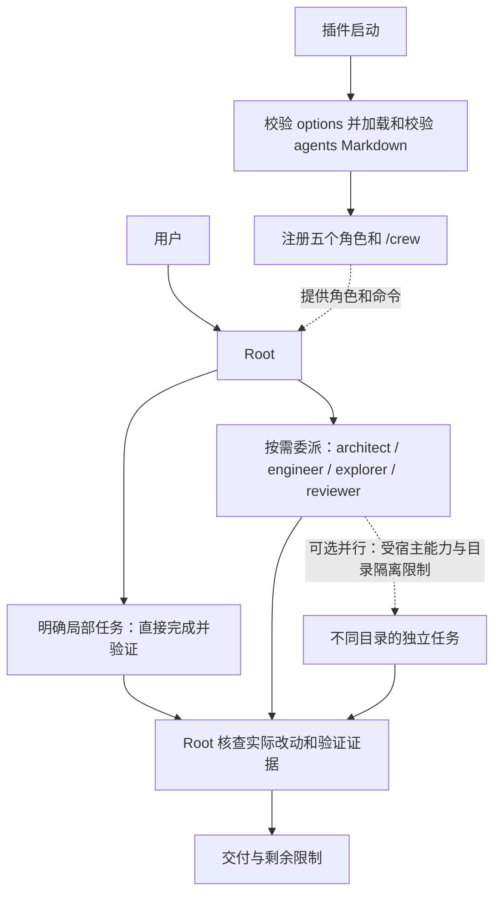

# OpenCode Crew

[English](README.md) | 简体中文

OpenCode V2 插件：文件化角色、按需委派，Root 保持正常执行能力。简单事情直接做，复杂事情分工做，结果按风险核查。

## 工作方式与并行现状



图中专家是按需选择，不是固定顺序或全部必经。Root 策略规定同一 cwd 同时只有一个写入者，Root 与 engineer 不同时修改；写入结束后再独立审查。仅不同目录的独立任务才考虑并行。

插件只注册角色和命令，没有自有调度器、队列、并发上限、锁、自动 worktree、依赖 DAG 或冲突检测。实际子代理调用与并发执行由 OpenCode 宿主能力及 Root 的工具使用决定；并行执行未在此宣称已实测。

## 安装与配置

要求 OpenCode **2.2.3**（已验证版本）。无需手工复制角色或运行安装脚本。

### 从 GitHub 安装（推荐）

```sh
opencode plugin add github:bioShaun/opencode-crew
```

也支持完整 Git 地址：

```sh
opencode plugin add git+https://github.com/bioShaun/opencode-crew.git
```

安装后，在已有 `opencode.json(c)` 中找到安装命令添加的 Crew 插件项，将它改成下方对象形式以配置模型。**替换该项，不要再追加第二份。** 仓库自带预构建入口，使用者无需手工创建角色或运行构建命令。

```jsonc
{
  "$schema": "https://opencode.ai/config.json",
  "plugins": [
    {
      "package": "github:bioShaun/opencode-crew",
      "options": {
        "models": {
          "root": "provider/root-model#high",
          "architect": "provider/architect-model#high",
          "engineer": "provider/implementation-model#medium",
          "explorer": "provider/fast-model",
          "reviewer": "provider/review-model#high"
        },
        "steps": { "engineer": 80, "reviewer": 30 }
      }
    }
  ],
  "default_agent": "root"
}
```

以上是待替换的占位模型，provider、凭证和模型可用性由目标机配置提供，包内不包含密钥或具体模型默认值。`models` 可省略部分角色；省略表示遵循 OpenCode 原生模型继承规则，不是字符串 `inherit`。子代理继承父会话模型；主会话保持其已选模型。`/crew` 会显式选择已配置的 Root 模型，未配置则保留当前会话模型。

不要覆盖现有完整配置，保留 provider 和其他插件。不要再在 `agents` 配置或自动发现的 `agents/*.md` 中定义 Crew 的五个同名角色，否则宿主的合并规则可能覆盖模型/提示词或追加权限。旧 planner-only 用户先备份并移出旧角色文件，再删除其配置块，不能同时启用两个编排包。

支持固定分支、标签或完整 commit，例如 `github:bioShaun/opencode-crew#main`。生产使用可固定经过验证的完整 commit。检查或更新可使用 `opencode plugin check` / `opencode plugin update`；完整 commit 固定的插件不随分支更新。

### 本地目录 / 离线分发

也可将完整仓库放到任意固定位置，将 `package` 改为该目录的绝对路径（例如 `/home/you/opencode/opencode-crew`）。插件不依赖特定安装路径。

可分发 `npm pack` 生成的 tgz，目标机解压到固定目录后按本地路径加载。`plugin add` 不接受 tgz 目标。归档与 Git 仓库均自带 `dist/index.js`，YAML 解析器已经打包，不要求额外安装解析依赖。从源码修改后分发前执行 `bun install && bun run build`。运行仍依赖宿主 OpenCode V2 的插件 SDK。当前没有发布 npm，不要用裸包名从 npm 安装。

## 使用

- `/crew`：切换到 Root 和已配置的 Root 模型，不发送空模型请求。
- `/crew <任务>`：切换并提交任务；保留附件、技能和投递方式。
- `default_agent: root` 用于未选角色的新会话，不强行改变已有会话；已有会话使用 `/crew`。
- 模型/步数在插件 options 修改，按 OpenCode 配置热加载机制生效，无需重启服务。

## 角色

| 角色 | 定位 | 权限边界 |
|---|---|---|
| root | 目标、决策、调度、验收；明确局部任务可直做并验证 | 不添加 planner-only 工具禁令，仍遵守宿主与会话策略 |
| architect | 按需制定复杂方案、接口和验证契约 | 仅可写当前工作目录的 `plans/`，无 shell/Code Mode |
| engineer | 按范围实现并自验证 | 不递归委派，默认 80 步 |
| explorer | 只读检索、日志与调用链摘要 | 不写入、不执行命令 |
| reviewer | 按风险独立核查 | 不写入；shell 仅五条固定只读 Git 命令 |

Root 的 Markdown 权限列表为空时，Crew 保留宿主提供的 Root 权限，不添加通配放行，也不绕过已有 ask/deny 规则；列表非空时则替换该权限列表。会话及其他宿主策略仍然生效。

不是固定流水线。Root 已掌握上下文，剩余修改和必要验证明确、局部，且无需进一步调查、设计测试或独立复核时可直做；否则优先委派。长任务才按需使用 `plans/`。同一 cwd 一次只能有一个写入者；直做不免验收。

## 文件即角色

```text
opencode-crew/
├── package.json
├── src/index.ts           # 解析配置、加载角色、注册 /crew
├── dist/index.js          # 分发入口，内含 YAML 解析器
└── agents/
    ├── root.md
    ├── architect.md
    ├── engineer.md
    ├── explorer.md
    └── reviewer.md
```

角色提示词、权限和默认步数只存在于 Markdown，插件源码不再保存第二份。Frontmatter 支持 `description`、`mode`、`steps`、`permissions`，正文为 system prompt。模型只通过插件 options 设置，非法字段/角色/模型格式直接报错，所有输入验证完才注册。

修改包内 Markdown 后使用 OpenCode `/reload` 强制完整重载以重新读取角色；不承诺宿主会自动监视包内所有嵌套文件。升级包可能覆盖自定义 Markdown，升级前保留自定义文件。当前不提供另一套自定义目录/别名机制，以免产生重复定义。

## 验证与限制

`bun install` 后运行 `bun test`。验收覆盖模型解析、native Root、只读角色、plans 写入范围、命令切换和附件保留、非法配置及空命令。

配置/注册与权限回读不等于真实模型链路验证。未跑付费的 Root→子代理多轮任务；运行结果还受目标机 provider、全局/会话权限、项目指令影响。路径权限不是操作系统沙盒，对不可信项目仍需额外隔离。

卸载：删除配置中的 Crew 插件项和 `default_agent: root`（或恢复之前的默认值）；本地包不再使用后自行移走。移除插件后已有会话不要继续选用 root，改选 build 或恢复的 planner。旧配置回滚应仅恢复迁移涉及项，避免覆盖后续无关修改。
